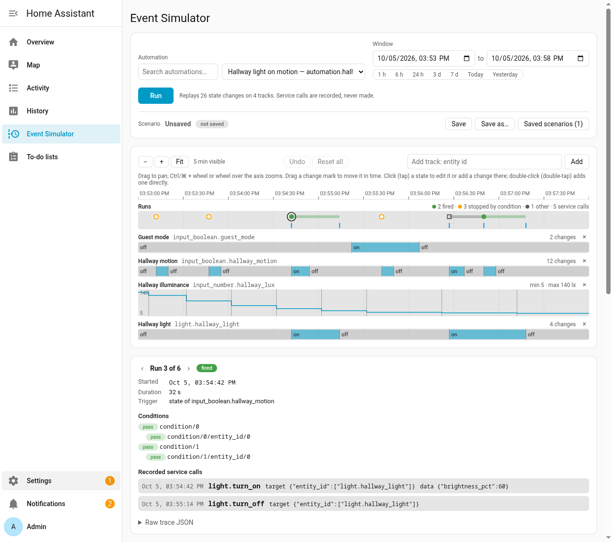

# Event Simulator for Home Assistant

[](https://github.com/eseverson/hass-event-simulator/releases)
[](LICENSE)
[](https://hacs.xyz)
[](https://github.com/eseverson/hass-event-simulator/actions/workflows/validate.yml)
[](https://github.com/eseverson/hass-event-simulator/actions/workflows/test.yml)

Replay recorded history against one automation, in a sandbox, and see what it would have done.

> **Event Simulator is not affiliated with, endorsed, recommended, or supported by the Home Assistant project.**
>
> This custom integration is provided as-is, without any warranty. A replay is a model of what your automation does, not a guarantee: it runs Home Assistant's own trigger, condition and script code, but against recorded states, on a virtual clock, with every service call faked.

Testing an automation usually means waiting for the real event, or flipping devices by hand and reading traces afterwards. This lets you pick an automation, pull the recorded history of the entities it depends on onto a timeline, change that timeline, and replay it. For each window you get:

- whether the automation fired, and when;
- which trigger started each run;
- which condition stopped a run that did not get through, or whether the run was dropped by its `mode`;
- which service calls it would have made, with their data and target.

Nothing it does touches the live instance: the replay runs in a separate process, and its service calls are recorded, not made.



## Install

Through HACS, add this repository as a custom repository with category **Integration**, then install it. Or copy `custom_components/event_simulator/` into your config directory yourself.

Either way:

1. Restart Home Assistant.
2. Settings → Devices & services → Add integration → **Event Simulator**.

The **Event Simulator** panel appears in the sidebar for admin users. It needs Home Assistant 2026.2.3 or newer and the recorder, which is where the history comes from; there is nothing else to install and no network access is needed.

## Using it

**Choose an automation.** The panel lists every automation entity. Picking one loads its config and gives a track to each entity its triggers, conditions and templates reference.

**Choose a window.** The default is the last 24 hours; presets and the start/end fields set any window up to 7 days. Each track is filled from the recorder: the state at the window start, then every recorded change inside it. Numeric entities draw as a line, everything else as state segments; `unavailable` and `unknown` are hatched, and replayed as the real states they are.

**Edit the timeline** for a what-if. Drag a change mark to move it in time (it snaps, and never passes its neighbors), click one to edit the state and attributes in effect there, add changes, or delete them. Add a track for any other entity by its id, or remove one. Edited tracks are marked; **Undo**, **Reset** per track and **Reset all** take you back to the recorded history.

**Edit the automation config** in the YAML editor under the timeline to try a different trigger, condition or action. The edit only changes what the simulator runs. It is never saved to Home Assistant, and **Revert to saved automation** puts the real config back. `!include`, `!secret` and other custom YAML tags are refused.

**Run** replays the window. Runs land on a results row under the shared time axis, marked fired, stopped by a condition, errored, or other (dropped by the automation's `mode`, cancelled by a restart, or unfinished). Selecting a run shows when it started and how long it took, the trigger, each condition's result, the step that stopped it, any error, and the service calls it recorded. Warnings from the replay (an event outside the window, a call to a service your instance does not have, a run still going when the replay ended) are listed with the results.

**Save** the setup as a named scenario to come back to it: the automation config (edited or not) and the automation it came from, the window, the tracked entities and the timeline, edits included. Scenarios are kept in `.storage/event_simulator.scenarios`, up to 100 of them. Loading one puts it back on screen as saved; it does not re-read the recorder, so a scenario still replays after the history behind it has been purged.

## How it works

Each Run starts a child process with the same Python interpreter Home Assistant runs on, importing the same `homeassistant` package, so triggers, conditions, templates and script steps behave as they do live, version for version. The child boots a throwaway Home Assistant in a temporary config directory with no recorder, HTTP server, frontend or network-facing integrations, sets up only the automation under test, and deletes the directory when it is done. It gets a minimal environment, so tokens and credentials in the live process's environment do not reach it. It copies the live instance's time zone, location, elevation and unit system, any Labs preview features you have turned on, and a slice of the entity, device, area, floor and label registries — the entries the automation and its tracks can see — so `area_entities()`, `device_attr()` and similar templates, and device triggers of entity-domain integrations such as `binary_sensor` and `light`, resolve as they do live.

Time in the child is virtual. Its event loop never sleeps: when nothing is ready to run it jumps straight to the next timer or timeline change, so a `for:` of an hour, a `delay`, a `time` trigger and a `sun` condition all see the time they would have seen, and a day replays in seconds. The initial states keep their recorded `last_changed`, so a `for:` early in the window counts from when the state really changed.

The replay attaches the automation at the window start, writes each timeline change at its time, and intercepts every service call at Home Assistant's service registry: the call is recorded with its time, data, target and the run that made it, answered with success, and never executed. The window is half-open, so a run triggered exactly at the end is discarded. Runs still in progress at the end (in a `delay`, a `wait_for_trigger`, a queue) get up to an hour of virtual time to finish; one still going after that is reported as unfinished. Results come from Home Assistant's own automation traces, and the full trace of each run is in the panel.

## Limitations

**Actions have no effect.** A recorded `light.turn_on` does not turn the light on in the replay, so anything later in the run that waits on the result — a `wait_template` on that light's state, a condition on it — sees the timeline, not the call. A `script.turn_on` or `automation.trigger` is recorded, not run. If the result matters, add the change it would have caused to the timeline yourself.

**One automation at a time.** The automation under test is the only one in the sandbox, so automations that trigger each other cannot be replayed together.

**Only state changes and time drive a replay.** The timeline holds state changes. Triggers that wait for something else — an `event` trigger, a webhook, a tag scan — have nothing to fire on, and a `homeassistant: start` trigger does not fire because the automation is attached after the sandbox has started.

**Some trigger and condition platforms cannot run.** Custom integrations are never loaded in the sandbox, so a trigger or condition from one is refused, as are device triggers, conditions and actions specific to an integration such as ZHA, MQTT or Hue (they need that integration's runtime state, not just its code). The error names each one by its place in the config. Device automations of entity domains (`binary_sensor`, `light`, `sensor`, ...) work. Whether custom platforms should ever be loaded is an open question, [#14](https://github.com/eseverson/hass-event-simulator/issues/14).

**History is what the recorder kept.** Entities excluded from the recorder have no history to load, and nothing older than the recorder's `purge_keep_days` is available.

**Clock caveats.** Home Assistant reads the time through a few functions the sandbox patches. Code that calls `datetime.now()` directly — some third-party libraries do — sees real time, as do context ids, log timestamps and anything measured with `time.monotonic` in a worker thread. Work handed to Home Assistant's executor takes zero virtual time. None of this affects Home Assistant's own trigger, condition and script paths.

**Size limits:**

| Limit | Value |
| --- | --- |
| Window | 7 days |
| Tracked entities | 50 |
| Timeline changes | 50,000 |
| Registry slice sent to the sandbox | 500 entities, 250 devices (the rest is dropped with a warning) |
| Edited automation YAML | 256 KiB, 100,000 nodes |
| Overrun after the window for runs in progress | 1 hour |
| Wall-clock time for one replay | 300 seconds |
| Replays at once | 2 (more wait their turn) |
| Saved scenarios | 100, names up to 100 characters |

## Development

```
uv venv --python 3.13 .venv && . .venv/bin/activate
uv pip install -r tests/requirements.txt
uv pip install "home-assistant-frontend==<version from homeassistant/components/frontend/manifest.json>"
pytest
node --test tests/panel/*.test.mjs
```

```
custom_components/event_simulator/
  __init__.py       entry setup, panel registration
  history.py        automations, recorded timelines, core config and registry snapshot
  runner.py         spawns the sandbox child: timeout, kill, crash surfacing
  store.py          saved scenarios (.storage/event_simulator.scenarios)
  websocket.py      event_simulator/* commands used by the panel
  config_flow.py    single-instance config entry
  sandbox/
    __main__.py     child entry point: scenario JSON on stdin, result JSON on stdout
    engine.py       boots the throwaway Home Assistant and replays the scenario
    vclock.py       virtual-time asyncio event loop and the clock patch
  panel/            the sidebar panel (plain web component, no build step)
```

The scenario and result formats are in [`docs/superpowers/specs/2026-10-05-event-simulator-design.md`](docs/superpowers/specs/2026-10-05-event-simulator-design.md); the replay's timeline (boot lead, seeding, end-of-window handling) is in `sandbox/engine.py`'s module docstring and the clock patch in `sandbox/vclock.py`'s.

Engine tests run scenarios through the real child process; the panel's pure functions are tested with `node --test` without a browser.

## License

[MIT](LICENSE).
